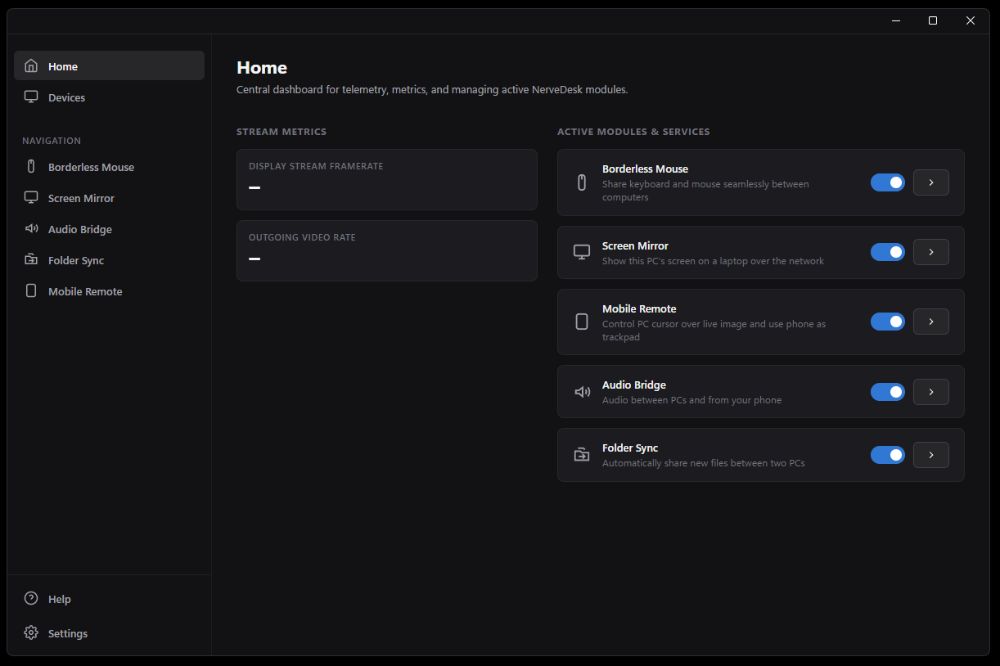
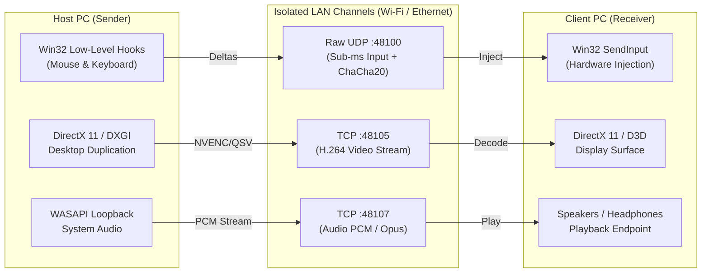

# NerveDesk

[](https://www.rust-lang.org/)
[](https://v2.tauri.app/)
[](https://learn.microsoft.com/en-us/windows/win32/direct3d11/direct3d-11-graphics)
[](https://learn.microsoft.com/en-us/windows-hardware/drivers/display/indirect-display-driver-model-overview)
[](https://tokio.rs/)
[](https://learn.microsoft.com/en-us/windows/win32/)
[](https://en.wikipedia.org/wiki/User_Datagram_Protocol)
[](https://learn.microsoft.com/en-us/cpp/build/reference/md-mt-ld-use-run-time-library)
[](LICENSE)
<br>

[](#core-features)
[](#core-features)
[](#core-features)
[](#core-features)
[](#core-features)
[](#core-features)
[](#core-features)
[](#core-features)
[](#core-features)

NerveDesk is a lightweight, low-latency hybrid KVM (Keyboard, Video, Mouse) and virtual display streaming application for Windows, built with Rust and Tauri v2. It connects multiple computers over a local network into a unified workspace, enabling seamless cursor transitions across monitor boundaries, virtual secondary screen projection, audio streaming, clipboard synchronization, and directory replication.



### Performance Highlights

- Binary Footprint: ~6–7 MB standalone executable (NSIS setup package is under 2 MB).
- Memory Usage: 10–15 MB RAM in active background operation (compared to 300–800 MB for Electron-based solutions).
- Input Latency: Sub-millisecond (< 1 ms) over local networks via raw UDP datagrams without TCP Head-of-Line Blocking.
- Video Transport: ~16 ms glass-to-glass latency at 60 FPS using a direct DirectX 11 GPU capture pipeline with under 2% host CPU usage.

## Tech Stack

- Systems Core: Rust 1.80+, Tokio asynchronous runtime, windows-rs / winapi, crossbeam channels.
- Graphics & Media: DirectX 11 (DXGI Desktop Duplication), Windows Graphics Capture, Media Foundation H.264 (Hardware MFT), WebCodecs API, WASAPI Audio Loopback.
- Display Driver: C++ UMDF v2 Indirect Display Driver (IddCx).
- Desktop GUI: Tauri v2, system WebView2, Windows DWM Immersive Dark Mode.


## Architectural Advantages



### Non-Blocking Input Transport
Traditional software KVMs rely on TCP, where dropped packets stall the entire event stream while waiting for retransmission. NerveDesk uses non-blocking Raw UDP sockets with monotonic sequence numbering, eliminating cursor hitching and micro-stutters during network spikes.

### Zero-Copy GPU Pipeline
Unlike solutions that copy frames into system RAM for software compression, NerveDesk captures frames directly inside GPU VRAM via DirectX 11 (DXGI Desktop Duplication) or Windows Graphics Capture. Frames are compressed using hardware encoders (NVENC, Intel QuickSync, AMD AMF) with ultra-low-latency CBR settings.

### Isolated Asynchronous Clipboard
Clipboard listening and writing run in an isolated Tokio background task. Large text or image payloads (including DIB/DIBV5 formats) are deduplicated with content hashing and streamed independently, preventing mouse input freezes.

### Lightweight Native Shell
Built using Rust and Tauri v2 with the system WebView2 runtime, NerveDesk avoids bundling a dedicated Chromium browser. It links the MSVC CRT statically, requiring no external .NET or runtime installations.


## Core Features

- Seamless Border Crossing: Move cursor naturally across configured screen boundaries (Left, Right, Top, Bottom) with automatic input trapping and Win32 SendInput injection.
- Virtual Display Extension: Uses a native Microsoft IddCx UMDF display driver to expose an actual physical monitor to Windows, supporting up to 4K resolution, custom EDID, and full DWM 3D acceleration.
- Screen Mirroring: Stream an entire desktop or a selected application window to another computer without requiring a display driver on the receiving device.
- Audio Bridge: Stream system audio bi-directionally between machines using low-latency WASAPI Loopback Capture.
- Phone Audio: Play Android or iPhone audio through the PC's speakers using Windows Bluetooth A2DP sink support. Pair the phone in Windows, then connect it from Audio Bridge.
- Folder Synchronization: Bi-directional background folder synchronization with 600 ms delta polling and safe change resolution.
- Mobile Web Remote: View live screen output and control input from a phone browser via an embedded HTTPS server secured by a 6-digit PIN. Add the page to the phone's home screen for the NerveDesk icon. A verified phone stays recognized while the PC app runs and the PIN remains unchanged.
- Continuity Camera & Virtual Webcam: Transform an iPhone or Android phone into a high-definition PC webcam for conferencing (Google Meet, Zoom, Discord, Teams) and streaming (OBS Studio). Features low-latency MJPEG streaming, virtual camera DirectShow/MediaFoundation driver integration, camera switching, torch/flash control, 90° rotation increments, mirroring, and direct OBS browser source URL copying.
- Mobile Game Streaming Mode: Ultra-low-latency game streaming directly to mobile browsers at 60 or 120 FPS powered by hardware-accelerated Media Foundation H.264 encoding and client-side WebCodecs decoding. Includes real-time performance HUD (host/device FPS, network packets, decoding queue), 720p/1080p resolution scaling, PC game audio forwarding, automatic landscape orientation lock, and screen wake lock.
- Quick Share: Scan the Mobile Remote QR code, enter the PIN, then send files, photos, text, or links from the phone's Share tab. Received files go to `Downloads` by default; choose another folder in Mobile Remote on the PC. Received text goes to the PC clipboard. Prepare one file and text in the PC app to download or copy on the phone (100 MB per file).
- Zero-Config LAN Discovery: Automatic device pairing on the local subnet via UDP broadcast beacons on port 48103 with alphanumeric security key verification.


## Documentation

### Specifications & System Architecture
- **[System Architecture](docs/ARCHITECTURE.md)**: High-level macro architecture, component topology, and subsystem maps.
- **[Wire Protocol Specification](docs/specs/PROTOCOL.md)**: NerveWire packet binary layouts, sequence semantics, and connection state machine.
- **[Concurrency & Threading Model](docs/CONCURRENCY.md)**: Dedicated Win32 hook threads, lock-free ring buffers, and Tokio worker pools.
- **[Threat Model & Security](docs/THREAT_MODEL.md)**: STRIDE analysis, trust boundaries, and cryptographic invariants.
- **[Privacy Architecture & Zero-Telemetry](docs/PRIVACY.md)**: Peer-to-peer data guarantees, volatile-memory lifecycle, and network audit procedures.
- **[Failure Modes & Recovery](docs/FAILURES_AND_RECOVERY.md)**: Panic release for stuck keys, DXGI device removal recovery, and firewall traversal.
- **[Compatibility Matrix](docs/COMPATIBILITY.md)**: Windows OS version support, GPU encoder capabilities, and network requirements.
- **[Architecture Decision Records (ADRs)](docs/adr/)**: Formal records of key architectural decisions (ADR-001 to ADR-009).
- **[RFCs & Design Proposals](docs/rfcs/)**: In-depth design documents, including zero-copy GPU video streaming.
- **[Screen Mirroring Guide](docs/MIRROR.md)**: Mirror and extend display modes, codec selection, and troubleshooting.
- **[Virtual Display Driver](docs/DRIVER.md)**: IddCx driver architecture, build steps, and signing requirements.
- **[Repository Structure](docs/STRUCTURE.md)**: Workspace layout, crate map, and dependency graph.
- **[Changelog](CHANGELOG.md)**: Version history adhering to Keep a Changelog.
- **[Contributing Guide](CONTRIBUTING.md)**: Environment setup, coding standards, and PR workflows.

### Crate References
- **[`common`](docs/crates/COMMON.md)**: Packet protocol, `InputEvent`, error types.
- **[`input`](docs/crates/INPUT.md)**: KVM hooks, edge detection, `SendInput` emulator.
- **[`net`](docs/crates/NET.md)**: All network transports, security primitives, mobile server.
- **[`capture`](docs/crates/CAPTURE.md)**: DXGI/WGC screen capture, IddCx loopback receiver.
- **[`codec`](docs/crates/CODEC.md)**: H.264 hardware encoding/decoding, JPEG fallback.
- **[`clipboard`](docs/crates/CLIPBOARD.md)**: Async clipboard synchronization.
- **[`engine`](docs/crates/ENGINE.md)**: Tokio service orchestration, AppState.

## Technical Scope & Trade-Offs

- Platform Specialization: NerveDesk is engineered specifically for Windows 10 and 11 to maximize performance through native Win32 hooks, DXGI, WASAPI, and IddCx driver integration.
- Driver Installation: Virtual display extension requires installing the bundled IddCx driver with administrative privileges. Mirroring and KVM modes operate without driver installation.
- Network Target: Optimized for high-throughput, low-latency performance within trusted local networks (Ethernet or 5 GHz Wi-Fi) rather than public WAN relays.


## Building from Source

### Prerequisites
- Windows 10 or 11 (64-bit)
- Rust 1.80+ (`x86_64-pc-windows-msvc` toolchain)
- Node.js 18+ (for UI bundling)
- Visual Studio 2022 with C++ Build Tools (and Windows Driver Kit for the IddCx driver)

### Build Standalone Binary
```powershell
$env:RUSTFLAGS="-C target-feature=+crt-static"
cargo build --release -p nervedesk-ui
```
Output: `target\release\NerveDesk.exe`

### Build NSIS Installer
```powershell
cd ui
npm run build
npx tauri build
```
Output: `target\release\bundle\nsis\NerveDesk_1.0.0_x64-setup.exe`

### CLI Daemons
Host daemon:
```powershell
cargo run -p host -- --target <CLIENT_IP>:48100 --stream-video
```

Client receiver:
```powershell
cargo run -p client -- --bind 0.0.0.0:48100 --recv-video
```

## Testing

Run workspace automated tests:
```powershell
cargo test --workspace
```


## License

This project is dual-licensed under either:

- Apache License, Version 2.0 ([LICENSE-APACHE](LICENSE-APACHE) or http://www.apache.org/licenses/LICENSE-2.0)
- MIT License ([LICENSE-MIT](LICENSE-MIT) or http://opensource.org/licenses/MIT)

at your option.
