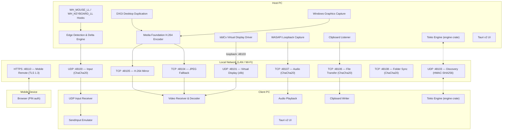

# Architecture & Data Flow

## Overview

NerveDesk is a low-latency hybrid KVM (Keyboard, Video, Mouse) and virtual display streaming application for Windows. It connects multiple PCs over a local network into a unified workspace. All channels are isolated to prevent Head-of-Line blocking and to match each payload's latency and reliability requirements.

---

## System Diagram

---

## Network Channel Map

| Port | Protocol | Payload | Encryption |
|------|----------|---------|------------|
| 48100 | UDP | Mouse deltas, keyboard scancodes | ChaCha20-Poly1305 + ReplayGuard |
| 48101 | UDP | BGRA frames from IddCx driver (zlib) | ChaCha20-Poly1305 |
| 48103 | UDP | Discovery beacons | Unsigned broadcast / HMAC-SHA256 unicast to paired peer |
| 48104 | TCP | JPEG mirror frames | ChaCha20-Poly1305 |
| 48105 | TCP | H.264 NAL units | ChaCha20-Poly1305 |
| 48106 | TCP | File transfer chunks | ChaCha20-Poly1305 |
| 48107 | TCP | PCM audio frames | ChaCha20-Poly1305 |
| 48108 | TCP | Folder sync records | ChaCha20-Poly1305 |
| 48109 | TCP | Audio bridge control | ChaCha20-Poly1305 |
| 48110 | HTTPS | Mobile remote (TLS 1.3) | TLS 1.3 + PIN session token |

---

## Subsystem Details

### Input Pipeline (KVM)

1. `WH_MOUSE_LL` and `WH_KEYBOARD_LL` hooks run in a dedicated thread at `THREAD_PRIORITY_TIME_CRITICAL`.
2. The **Edge Detection** engine watches cursor position against configured monitor boundaries (Left, Right, Top, Bottom).
3. On a boundary crossing, the host cursor is clipped and relative deltas are packed into a compact binary frame (`InputEvent`).
4. Each frame is encrypted with ChaCha20-Poly1305 using a BCryptGenRandom nonce and the shared pairing key.
5. The client receives datagrams via `UdpInputReceiver`, verifies the AEAD tag and replay guard, then injects events through `SendInput`.

**Why UDP:** Dropped motion packets are irrelevant — only the latest cursor delta matters. TCP Head-of-Line blocking would cause visible cursor stutter on any packet loss. See [ADR-001](adr/ADR-001-udp-for-input.md).

### Display & Video Pipeline

**Mirror mode (driverless):**
- `DXGI Desktop Duplication` or `Windows Graphics Capture` captures frames as GPU textures.
- Frames are converted to NV12 and encoded by Windows Media Foundation (NVENC / AMF / QuickSync).
- H.264 NAL units are framed and streamed over TCP 48105. If hardware encoding is unavailable, JPEG is sent over TCP 48104.
- The receiver decodes and presents frames in a fullscreen Win32 window.

**Extend mode (IddCx driver required):**
- The `idd-virtual-display` UMDF driver exposes a virtual Windows monitor.
- The driver pushes raw BGRA swap-chain frames to the NerveDesk app over loopback TCP 48103.
- The app compresses frames with zlib and transmits them over UDP 48101.

See [Screen Mirror](MIRROR.md) and [Virtual Display Driver](DRIVER.md).

### Audio Bridge

- The sender captures the system default render endpoint using **WASAPI Loopback Capture** (`AUDCLNT_STREAMFLAGS_LOOPBACK`).
- PCM frames are authenticated and encrypted, then streamed to the peer over TCP 48107.
- A reverse stream can be requested via TCP 48109 — the peer begins sending audio back.
- Connections are restricted to the configured `paired_peer_ip`.

### Clipboard Synchronization

- `AddClipboardFormatListener` detects clipboard changes on both machines.
- Content is hashed (SHA-256) to deduplicate identical payloads.
- Supported formats: `CF_TEXT`, `CF_UNICODETEXT`, `CF_DIB`, `CF_DIBV5`.
- Transfer runs in an isolated Tokio task so large payloads never block the input pipeline.

### Folder Synchronization

- Setup handshake is encrypted with the pairing key; the receiver must approve via the UI.
- After approval, a per-session nonce is generated; all records are encrypted (`ChaCha20-Poly1305`) with directional context strings.
- A SHA-256 hash verifies every transferred file.
- Conflicting edits keep both copies; replaced or deleted files are moved to version history.
- The peer with the lexicographically smaller hostname coordinates bidirectional scans every 600 ms.

### File Transfer

- Magic bytes `NRV2` authenticate the connection before data flows.
- Files are transferred in 64 KB encrypted chunks over TCP 48106.
- Maximum file size: 16 GB.

### Mobile Remote

- An embedded HTTPS server listens on TCP 48110.
- TLS 1.3 only (rustls), with a self-signed certificate generated per local IP address.
- The certificate private key is protected with Windows DPAPI.
- A 6-digit cryptographic PIN (BCryptGenRandom) gates access. Five failed attempts per IP trigger a 5-minute block.
- Successful PIN verification issues a 32-byte random session token valid for one hour.
- The screen can be viewed as a MJPEG stream (`/stream`) or a snapshot (`/screen.jpg`) — both require an active session token.

### Device Discovery

- `DiscoveryBeaconEmitter` broadcasts JSON beacons on UDP 48103 every second.
- Broadcast beacons are unsigned (so unpaired devices can discover the host).
- Unicast beacons sent directly to the configured paired peer are signed with **HMAC-SHA256** over the pairing key.
- `DiscoveryListener` rejects unsigned beacons from the paired peer IP to prevent beacon spoofing.

See [ADR-004](adr/ADR-004-hmac-discovery-beacons.md).

---

## Security Architecture

| Mechanism | Implementation |
|---|---|
| Pairing key storage | Windows DPAPI (`CryptProtectData`) — bound to user account |
| Data channel encryption | ChaCha20-Poly1305 AEAD (256-bit key derived via SHA-256) |
| Nonce generation | `BCryptGenRandom` (Windows CSPRNG) |
| Replay protection | `ReplayGuard` with a 4096-nonce sliding window |
| Discovery authentication | HMAC-SHA256 unicast to paired peer; unsigned broadcast otherwise |
| Mobile transport | TLS 1.3 (rustls + rcgen self-signed cert) |
| Mobile authentication | 6-digit PIN + 1-hour session token (32 bytes crypto-random) |
| Mobile brute-force limit | 5 attempts per IP → 5-minute block |
| IP filtering | All TCP/UDP data receivers accept connections only from `paired_peer_ip` |

Forward secrecy is not provided for PC-to-PC channels (shared secret, no ephemeral key exchange). Rotate the pairing key on both machines after any suspected exposure. See [ADR-002](adr/ADR-002-chacha20-aead.md) and [ADR-003](adr/ADR-003-dpapi-key-storage.md).

---

## Crate Reference

| Crate | Responsibility | Doc |
|---|---|---|
| `common` | Packet protocol, InputEvent, error types | [COMMON.md](crates/COMMON.md) |
| `input` | Windows hooks, edge detection, SendInput | [INPUT.md](crates/INPUT.md) |
| `net` | All network transports, security primitives | [NET.md](crates/NET.md) |
| `capture` | DXGI/WGC frame capture, IddCx loopback | [CAPTURE.md](crates/CAPTURE.md) |
| `codec` | H.264 encoder/decoder, JPEG fallback | [CODEC.md](crates/CODEC.md) |
| `clipboard` | Async clipboard sync | [CLIPBOARD.md](crates/CLIPBOARD.md) |
| `engine` | Tokio service orchestration, AppState | [ENGINE.md](crates/ENGINE.md) |
| `host` | Host CLI daemon | — |
| `client` | Client CLI daemon | — |
| `ui` | Tauri v2 desktop application | — |
| `driver` | IddCx virtual display (C++ UMDF) | [DRIVER.md](DRIVER.md) |
