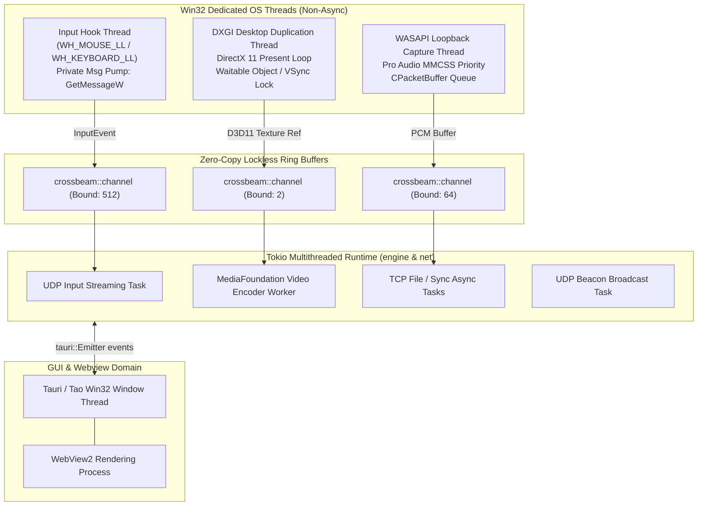

# Concurrency, Threading & Memory Architecture

| Field | Value |
|---|---|
| Target Architecture | Windows x64 / ARM64 Multicore |
| Async Runtime | Tokio 1.40 (Multi-Threaded Work-Stealing) |
| Inter-Thread Communication | `crossbeam-channel`, Tokio `mpsc`, `std::sync::Arc` |

---

## 1. Concurrency Model Overview

NerveDesk bridges Windows Kernel/User-Mode boundaries with real-time networking. A common pitfall in hybrid GUI/network applications is blocking the async runtime with Win32 message pumps or doing heavy video encoding inside network sockets.

To avoid latency spikes and deadlocks, NerveDesk enforces a **strict isolation of execution domains**:

---

## 2. Thread Taxonomy & Priority Assignment

| Thread Name | Runtime Nature | OS Priority / MMCSS Class | Purpose / Constraints |
|---|---|---|---|
| **`win32-input-hook`** | Native Win32 OS Thread | `THREAD_PRIORITY_HIGHEST` | Must never call async locks or disk I/O. Windows drops hooks exceeding 50 ms execution time (`LowLevelHooksTimeout`). |
| **`dxgi-capture`** | Native Win32 OS Thread | `THREAD_PRIORITY_ABOVE_NORMAL` | Polls `AcquireNextFrame` synchronized with monitor refresh rate. Drops stale frames if encoder is busy. |
| **`wasapi-audio`** | Native Win32 OS Thread | MMCSS: `"Audio"` | Real-time audio stream capture. Guarantees glitch-free buffer capture from Windows audio engine. |
| **`tokio-runtime-worker-*`** | Tokio Work-Stealing Pool | `THREAD_PRIORITY_NORMAL` | Handles network sockets (epoll/IOCP via mio), encryption, file I/O, and periodic state machines. |
| **`tauri-main-ui`** | Win32 Main UI Thread | `THREAD_PRIORITY_NORMAL` | Manages top-level window message pump, system tray events, and IPC command dispatching. |

---

## 3. Lock-Free Principles & Hot Path Optimization

### 3.1 Bounded Queues
- Input events flow through `crossbeam_channel::bounded(512)`. If network is completely blocked, oldest mouse moves are dropped in favor of freshest deltas. Mouse cursor state never lags behind real time.
- Video frames use a buffer depth of **2 frames** (`bounded(2)`). If the network or encoder cannot keep up with 60 FPS, the capture thread drops the middle frame rather than buffering frames in RAM.

### 3.2 State Synchronization & Mutex Hierarchy
Application state is encapsulated in `AppState` (`engine` crate) using lightweight `parking_lot` or `std::sync::Mutex` guards with strict lock ordering:
1. `paired_peer_ip` lock.
2. `paired_security_key` lock.
3. Feature flags (`AtomicBool` / `AtomicU64`).

**Lock Hierarchy Invariant**: No lock may be held while awaiting an asynchronous future or network I/O. Lock scope is strictly limited to synchronous pointer/value swaps.
