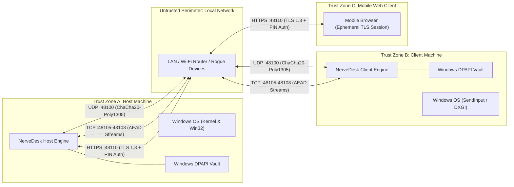

# Threat Model & Security Architecture

| Field | Value |
|---|---|
| Target System | NerveDesk Hybrid KVM & Display Streaming Suite |
| Document Version | 1.0.0 |
| Standard Framework | STRIDE / Microsoft Threat Modeling Process |
| Classification | Public Architecture Document |

---

## 1. Overview & Trust Boundaries

NerveDesk bridges input, audio, display frames, and filesystem operations across distinct computing devices over local networks (Ethernet, Wi-Fi, or direct ad-hoc links). Because keystrokes and screen contents represent high-value sensitive data, every communication channel crosses an untrusted network perimeter.

### Trust Boundary Definitions:
1. **Host Boundary (`TrustZoneA`)**: Local processes on the host. Protected by Windows user token isolation.
2. **Client Boundary (`TrustZoneB`)**: Local processes on the client. Protected by Windows user token isolation.
3. **Network Boundary (`UntrustedNet`)**: All network interfaces (`0.0.0.0`), packet sniffers, or compromised nodes on the shared Wi-Fi router.
4. **Mobile Boundary (`TrustZoneC`)**: Unauthenticated mobile browsers within LAN range before entering PIN.

---

## 2. STRIDE Threat Analysis

| Category | Threat Description | Attacker Objective | NerveDesk Mitigation |
|---|---|---|---|
| **S**poofing | Attacker injects fake discovery beacons or connects as legitimate PC | Impersonate trusted peer | HMAC-SHA256 beacon validation (ADR-004) & cryptographic pairing keys. |
| **T**ampering | Man-in-the-Middle alters mouse/keyboard packets or file bytes | Inject arbitrary keystrokes / malicious binaries | ChaCha20-Poly1305 authenticated encryption (AEAD) across all UDP & TCP streams (ADR-002). Corrupted tags drop packets immediately. |
| **R**epudiation | Malicious or unauthorized connection attempts | Deny activity / evade logs | Structured trace logging with timestamped peer identity and physical network interface binding. |
| **I**nformation Disclosure | Eavesdropping on Wi-Fi to capture passwords or screen content | Read sensitive clipboard, video, or keystrokes | End-to-end payload encryption with 256-bit symmetric keys. Zero plaintext transmission over wire. |
| **D**enial of Service | Flooding UDP port :48100 or TCP streaming ports | Freeze input, exhaust CPU, crash application | Fixed-size UDP input buffers, strict payload size bounds (max 64 KB datagrams), and single-connection exclusivity for active sessions. |
| **E**levation of Privilege | Exploitation of IddCx virtual display driver or installer hooks | Gain kernel or SYSTEM execution | Virtual display driver runs in User-Mode Driver Framework (UMDF 2.x). Driver package signed and validated by Windows driver integrity subsystem. |

---

## 3. Cryptographic Invariants

1. **At-Rest Key Storage**:
   - Master security keys are never stored as plaintext in configuration files or SQLite databases.
   - Keys are encrypted with the logged-in Windows user credentials using **Windows Data Protection API (`CryptProtectData`)** before persisting to disk (see [ADR-003](adr/ADR-003-dpapi-key-storage.md)).
2. **In-Flight Key Hygiene**:
   - Nonces for ChaCha20-Poly1305 are strictly 96-bit monotonic counters per session. Nonces are never reused with the same key.
   - Replay protection implements a sliding window of 4096 nonces (`ReplayGuard`). Packets with duplicate or backward-shifted sequence IDs are discarded before authentication validation.
3. **Mobile Remote Security**:
   - Web application traffic requires TLS 1.3 with high-strength cipher suites.
   - Ephemeral self-signed certificates are scoped to the local IP address.
   - Authentication enforces a 6-digit cryptographic PIN with rate limiting (5 failed attempts locks authentication for 60 seconds).

---

## 4. Attack Surface Reduction & Residual Risks

- **Residual Risk: Physical Host Compromise**: If an attacker gains administrator access to the Windows host, they can intercept DPAPI keys and memory. This is considered outside the threat model boundary of application-level software.
- **Residual Risk: Driver Test-Signing Mode**: On test environments without WHQL attestation, enabling test-signing weakens kernel code integrity against arbitrary kernel drivers. Production builds enforce signed driver catalog verification.
