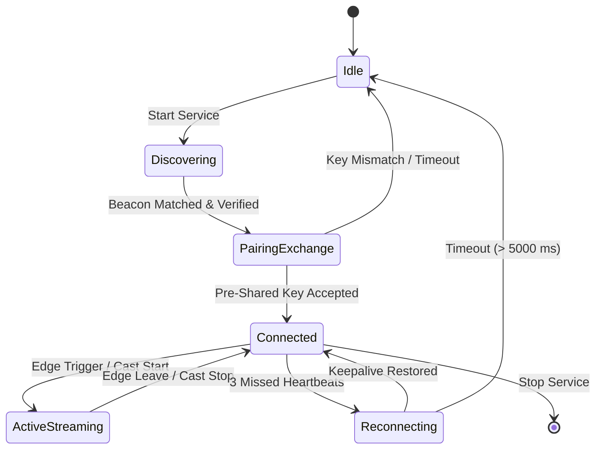

# Wire Protocol Specification (NerveWire v1)

| Field | Value |
|---|---|
| Protocol Name | NerveWire |
| Specification Version | 1.0.0-RFC |
| Default Ports | UDP 48100, 48101, 48103; TCP 48104, 48105, 48106, 48107, 48108; HTTPS 48110 |
| Byte Order | Big-Endian (Network Byte Order) |

---

## 1. Protocol Architecture & Port Assignment

NerveDesk separates concerns into distinct ports and transport layers to prevent Head-of-Line (HoL) blocking and eliminate cross-subsystem latency contamination.

| Port | Transport | Subsystem | Framing / Payload Format | Encryption |
|---|---|---|---|---|
| **48100** | UDP | Seamless Input (KVM) | Raw datagrams (fixed-header binary) | ChaCha20-Poly1305 (96-bit nonce) |
| **48101** | UDP | Virtual Display Slices | Multi-part UDP frame chunks | zlib / optional ChaCha20 |
| **48103** | UDP | Discovery Beacons | Broadcast / Multicast JSON packet | HMAC-SHA256 signature |
| **48104** | TCP | JPEG Video Fallback | Length-prefixed JPEG frames | TLS / ChaCha20-Poly1305 |
| **48105** | TCP | H.264 Video Stream | Annex-B NAL unit stream (SPS/PPS/IDR/P) | Length-prefixed ChaCha20 AEAD |
| **48106** | TCP | File Transfer | Chunked file transfer protocol | ChaCha20-Poly1305 AEAD |
| **48107** | TCP | Low-Latency Audio | Opus / Raw PCM 48kHz stereo frames | ChaCha20-Poly1305 AEAD |
| **48108** | TCP | Folder Sync Engine | Metadata sync + bidirectional differential stream | ChaCha20-Poly1305 AEAD |
| **48110** | TCP | Mobile Web Remote | HTTPS / WSS WebSockets | TLS 1.3 (ChaCha20 / AES-GCM) |
| **48112** | TCP | Mutual Device Pairing | Challenge-response authentication & key handshake | ChaCha20-Poly1305 AEAD |

---

## 2. Low-Latency Input Datagram Format (:48100)

Input packets are delivered over connectionless UDP. Total datagram overhead is strictly minimized to ensure single-packet MTU fit (< 128 bytes).

### 2.1 Packet Layout

```text
 0                   1                   2                   3
 0 1 2 3 4 5 6 7 8 9 0 1 2 3 4 5 6 7 8 9 0 1 2 3 4 5 6 7 8 9 0 1
+-+-+-+-+-+-+-+-+-+-+-+-+-+-+-+-+-+-+-+-+-+-+-+-+-+-+-+-+-+-+-+-+
|       Magic: 'N' 'R'          |  Version (1)  |  Packet Type  |
+-+-+-+-+-+-+-+-+-+-+-+-+-+-+-+-+-+-+-+-+-+-+-+-+-+-+-+-+-+-+-+-+
|                     Sequence Number (u32)                     |
+-+-+-+-+-+-+-+-+-+-+-+-+-+-+-+-+-+-+-+-+-+-+-+-+-+-+-+-+-+-+-+-+
|                     Timestamp Micros (u64)                    |
|                                                               |
+-+-+-+-+-+-+-+-+-+-+-+-+-+-+-+-+-+-+-+-+-+-+-+-+-+-+-+-+-+-+-+-+
|                     Nonce Counter (96 bits)                   |
|                                                               |
|                                                               |
+-+-+-+-+-+-+-+-+-+-+-+-+-+-+-+-+-+-+-+-+-+-+-+-+-+-+-+-+-+-+-+-+
|               Encrypted Input Payload (Variable)              |
|                                                               |
+-+-+-+-+-+-+-+-+-+-+-+-+-+-+-+-+-+-+-+-+-+-+-+-+-+-+-+-+-+-+-+-+
|                  Poly1305 AEAD Tag (128 bits)                 |
|                                                               |
|                                                               |
|                                                               |
+-+-+-+-+-+-+-+-+-+-+-+-+-+-+-+-+-+-+-+-+-+-+-+-+-+-+-+-+-+-+-+-+
```

### 2.2 Field Definitions
- **Magic (2 bytes)**: Constant `0x4E52` (`"NR"`). Packets missing this header are dropped without crypto evaluation.
- **Version (1 byte)**: Protocol major version (`0x01`).
- **Packet Type (1 byte)**:
  - `0x01`: Mouse Relative Movement (`dx: i32`, `dy: i32`).
  - `0x02`: Mouse Button Down (`button: u8`).
  - `0x03`: Mouse Button Up (`button: u8`).
  - `0x04`: Mouse Wheel / Scroll (`delta: i16`, `horizontal: bool`).
  - `0x05`: Keyboard Key Down (`vk: u16`, `scancode: u16`, `flags: u8`).
  - `0x06`: Keyboard Key Up (`vk: u16`, `scancode: u16`, `flags: u8`).
  - `0x07`: Keepalive / Heartbeat Ping.
  - `0x08`: Keepalive / Heartbeat Pong.
- **Sequence Number (4 bytes)**: Monotonically increasing identifier to drop stale or out-of-order packets.
- **Timestamp (8 bytes)**: Unix microsecond timestamp for glass-to-glass latency telemetry.
- **Nonce (12 bytes)**: ChaCha20 unique initialization vector.
- **Encrypted Payload (N bytes)**: Bincode serialized `InputEvent`.
- **Poly1305 Tag (16 bytes)**: Message authentication code protecting Header + Payload.

---

## 3. Discovery Protocol (:48103)

Peers discover each other on the local subnet by broadcasting periodic UDP beacons every 2,000 ms.

### 3.1 Beacon Payload Format (JSON over UDP)

```json
{
  "device_name": "Studio-Workstation",
  "ip": "192.168.1.120",
  "tcp_port": 48105,
  "role": "Host",
  "version": "1.0.0",
  "capabilities": ["kvm", "display_cast", "audio", "file_sync"],
  "signature": "a8f3b2...64-char-hex-hmac-sha256"
}
```

### 3.2 Authentication Rule
`signature` is computed over `device_name + ip + role + version` using the shared pairing secret key via HMAC-SHA256. Beacons failing cryptographic verification are ignored to mitigate rogue device spoofing.

---

## 4. Connection State Machine



---

## 5. Video Streaming & FEC Protocol (:48105)

H.264 access units are partitioned into chunk packets protected by Forward Error Correction (FEC).

### 5.1 Chunk Packet Layout

```text
 0                   1                   2                   3
 0 1 2 3 4 5 6 7 8 9 0 1 2 3 4 5 6 7 8 9 0 1 2 3 4 5 6 7 8 9 0 1
+-+-+-+-+-+-+-+-+-+-+-+-+-+-+-+-+-+-+-+-+-+-+-+-+-+-+-+-+-+-+-+-+
|       Chunk Index (u16)       |       Total Chunks (u16)      |
+-+-+-+-+-+-+-+-+-+-+-+-+-+-+-+-+-+-+-+-+-+-+-+-+-+-+-+-+-+-+-+-+
|   Flags (u8)  |              Payload Data ...                 |
+-+-+-+-+-+-+-+-+                                               +
|                                                               |
+-+-+-+-+-+-+-+-+-+-+-+-+-+-+-+-+-+-+-+-+-+-+-+-+-+-+-+-+-+-+-+-+
```

### 5.2 Header Fields
- **Chunk Index (2 bytes BE)**: 0-based index of this packet within the current frame group.
- **Total Chunks (2 bytes BE)**: Total number of packets comprising the frame, including parity chunks.
- **Flags (1 byte)**:
  - `0x00`: Standard data chunk containing H.264 bitstream slice.
  - `0x01`: FEC Parity chunk computed across payload bytes of preceding chunks.
- **Payload Data**: Variable slice data or parity vector.

### 5.3 Recovery Mechanism
When a single packet in a group is lost, the receiver calculates:
$$\text{MissingPayload} = P_{\text{parity}} \oplus \bigoplus_{i \neq \text{missing}} C_i$$
This reconstructs the missing slice with zero round-trip latency, eliminating TCP retransmission stalls.
